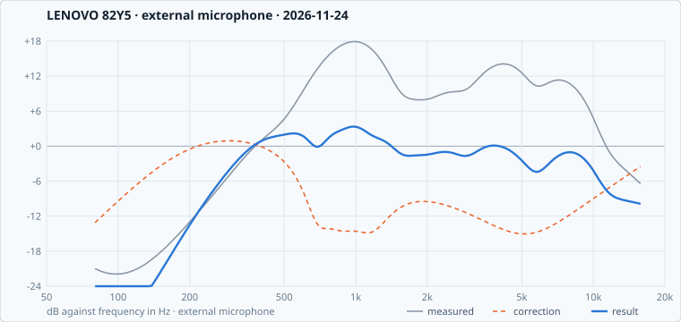

# LENOVO 82Y5

1 shared calibration for this machine, best first. The Omarchy Speaker Calibrator finds these by itself on a matching machine.

**Vendor tuning:** [rendered for Omarchy](../../../tunings/lenovo/82y5/README.md) from `2026-11-24-external-b17e862cba`.

## `2026-11-24-external-b17e862cba`

**good**, score **71** · external microphone · measured 2026-11-24 · plugin 1.3.0 · checked: pass, 7.5 → 3.6 dB from target · [#27](../../../../../issues/27)

